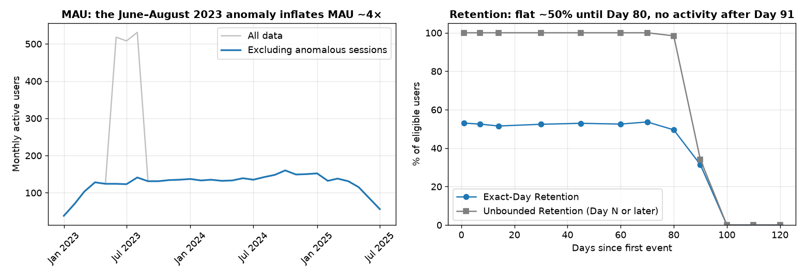

# E-commerce Product Analytics Portfolio Case Study

An end-to-end product analytics case study in DuckDB SQL, pandas and matplotlib on a synthetic e-commerce dataset (1,000 users, ~80,000 events, January 2023 – August 2025). It covers data quality, engagement, retention cohorts, purchase retention, the purchase funnel, user behavior, and acquisition cost and lifetime value (CAC/LTV).

## At a glance

**What this project demonstrates**

- **Data quality before metrics.** An undocumented anomaly in the data was found, investigated and excluded, and its effect is shown on every affected metric.
- **Appropriate denominators and observation windows.** Retention and fixed-window conversion rates use eligibility rules and fully observed windows, with closed vs open-ended intervals chosen deliberately; LTV comparisons account for differences in follow-up time with a common 12-month horizon.
- **Stress-testing findings before reporting them.** Comparisons with other actions, stratification by activity, results without outlier customers and on a common time horizon.
- **Separating facts from hypotheses.** Properties of the synthetic data are not presented as product insights, and associations are not presented as causal effects.
- **A reproducible pipeline.** SQL files → CSV results → notebooks; rebuilding the database from the source CSVs re-creates every result byte for byte.

**Key findings**

1. **A data anomaly distorts most metrics.** 2,165 identical sessions in June–August 2023, mostly recorded before users signed up, inflate MAU about 4×, raise funnel conversion from 45.2% to 66.2% and move 367 users from later cohorts into the June 2023 cohort (405 users instead of 38; matched by user ID). For primary metrics, engagement, retention, funnel and user-behaviour analyses use the cleaned table `events_clean`; the original `events` table is retained for comparison where relevant. Acquisition and monetization use user, acquisition-cost and subscription data.
2. **Standard retention metrics hide when activity stops.** Exact-Day Retention is flat at about 50% until Day 80, then falls to 0% on every measured day from Day 100 on: no user has an event later than Day 91 after their first event. D30 Unbounded Retention (100%) and Bracket Retention (97–100%) cannot show this.
3. **The funnel cannot be read as friction.** Sequential funnel conversion (all five steps in order) is 0%, 8.5% or 45.2% depending on the conversion window (7 days, 30 days, no limit), and the order of events is inconsistent with a purchase journey.
4. **The apparent feature advantage disappears after controlling for early activity.** Users with a `feature_click` complete the funnel at 56.0% vs 17.5%, but every other action shows a similar gap, and within groups of users with similar early activity the advantage does not remain. The data provide no convincing evidence of a feature-specific advantage.
5. **LTV/CAC by channel is driven by CAC and a few large customers.** 41 Enterprise subscribers (4.1% of users) bring 49.9% of revenue; without them, revenue per user is similar in all channels. With Enterprise customers included, Partner is the only channel whose users do not pay back their acquisition cost within 12 months (0.91); without them, App Store is also below 1 (0.85).



## Analyses

| # | Analysis | Notebook | SQL |
|---|---|---|---|
| 00 | Exploration and data quality | — | [sql/00_exploration](sql/00_exploration/00_exploration.sql) |
| 01 | Engagement: DAU, WAU, MAU, stickiness; the June–August 2023 anomaly | [01_engagement.ipynb](notebooks/01_engagement.ipynb) | [sql/01_engagement](sql/01_engagement/) |
| 02 | Retention: exact-day, bracket and unbounded retention by monthly cohort; retention beyond Day 30 | [02_retention_cohorts.ipynb](notebooks/02_retention_cohorts.ipynb) | [sql/02_retention_cohorts](sql/02_retention_cohorts/) |
| 03 | Purchase retention: the same retention types for repeat purchases; repeat purchases beyond Day 30 | [03_purchase_retention.ipynb](notebooks/03_purchase_retention.ipynb) | [sql/03_purchase_retention](sql/03_purchase_retention/) |
| 04 | Purchase funnel: sequential funnel, conversion windows, sequence check, segments | [04_funnel.ipynb](notebooks/04_funnel.ipynb) | [sql/04_funnel](sql/04_funnel/) |
| 05 | User behavior: activity, session check, behavioral cohorts | [05_user_behavior.ipynb](notebooks/05_user_behavior.ipynb) | [sql/05_user_behavior](sql/05_user_behavior/) |
| 06 | Acquisition and monetization: CAC, subscription revenue, LTV/CAC by channel, 12-month LTV | [06_acquisition_monetization.ipynb](notebooks/06_acquisition_monetization.ipynb) | [sql/06_cac_ltv](sql/06_cac_ltv/) |

Every notebook follows the same structure: business questions, metric definitions, SQL, results, findings, product interpretation, next questions and limitations.

## Findings by analysis

<details>
<summary><b>01 — Engagement</b></summary>

- **Stable core audience:** after growing in the first half of 2023, MAU stays at 131–160 users from September 2023 to April 2025.
- **Stable stickiness:** about 40% of monthly active users are active on a typical day (average DAU/MAU 39.86%), i.e. about 12 active days per month.
- **The mid-2023 MAU spike cannot be treated as organic growth:** 2,165 identical sessions in June–August 2023 inflate MAU about 4× and make stickiness look ~3× lower. They are excluded from the main metrics, and both versions are shown on the charts.
- **The 2025 decline coincides with the end of sign-ups:** no new users sign up after 20 May 2025, while stickiness stays at its usual level until June 2025. Whether this is a real decline or dataset truncation cannot be determined from the data.

</details>

<details>
<summary><b>02 — Retention</b></summary>

- **The anomaly also distorts cohorts:** cohorts are defined by a user's first event, and the anomalous sessions move users into the June–July 2023 cohorts long before they sign up. On all data, the June 2023 cohort has 405 users with 7% Day 7 retention, 367 of whom belong to later cohorts on cleaned data; on cleaned data it has 38 users with 50%.
- **Retention is flat at about 50% in the first 30 days:** on cleaned data, Exact-Day Retention is 52–53% on Day 1, Day 7 and Day 30 (both averaged by cohort and weighted by user).
- **After about three months, activity is no longer observed:** Exact-Day Retention stays at 49.5–53.6% until Day 80, then falls to 31.43% on Day 90 and 0% from Day 100, while 964–988 users are still eligible; no user has an event 100 or more days after their first event. The data do not establish whether this is real churn or a property of the synthetic data or observation process.
- **Longer-window metrics do not differentiate cohorts:** Bracket Retention averages 97–100% across cohorts (no cohort below 89%), and D30 Unbounded Retention is 100% in every cohort; this only shows that every user is still active at some point after Day 30.

</details>

<details>
<summary><b>03 — Purchase retention</b></summary>

- **The anomaly does not affect purchases:** the anomalous sessions contain no `checkout_complete` events, so `events` and `events_clean` have the same 4,517 purchases; 967 of 1,000 users make at least one purchase.
- **Repeat purchases on a specific day are rare, but common over wider windows:** weighted by user, 4.34% of eligible users buy again exactly on Day 7, 26.89% within Day 1–7, 52.38% within Day 15–30 and 76.4% on Day 30 or later (each rate uses its own eligible users).
- **No clear decline in the first month; observed repeat purchases decline as observed activity ends:** during the first 30 days, the bracket values are consistent with a roughly constant daily repeat-purchase rate of about 4.5%. In closed intervals, 70.5% of eligible users buy again in Day 1–30, 68.2% in Day 31–60, 44.85% in Day 61–90 and 0% in Day 91–120. The decline coincides with the end of users' observed activity (a median of 76 days after the first purchase), so Day 31+ and D30 Unbounded do not show long-term repeat purchasing.
- **Returning and buying are different behaviours:** on Day 7, 52.5% of users are active in the product and 4.34% of eligible users make a repeat purchase. The metrics use different cohorts and denominators, so the gap is a starting point for further analysis rather than a measure of how many active users buy.

</details>

<details>
<summary><b>04 — Purchase funnel</b></summary>

- **Funnel conversion without a time limit is 45.2%:** of 972 visitors, 89.1% view a product, 74.3% add to cart, 59.4% start checkout and 45.2% complete a purchase through the sequential funnel.
- **The anomaly strongly inflates the funnel:** on all data, overall conversion is 66.2%, because the anomalous sessions supply the first three funnel steps.
- **The conversion window changes the result completely:** sequential funnel conversion (all five steps in order) is 0% within 7 days, 8.5% within 30 days and 45.2% without a time limit, although 30.6% of visitors make some purchase within 7 days without going through the steps in order.
- **The observed event sequences are inconsistent with a purchase journey:** only 4.7% of purchase events have a checkout start in the 24 hours before, and after checkout start the next event is any event type with almost equal frequency, so drop-offs between steps cannot be reliably interpreted as friction.

</details>

<details>
<summary><b>05 — User behavior</b></summary>

- **Users are active in a very similar way:** each of the 13 event types is 7.5–7.8% of events, a user has 20 to 100 events, and every user is active for 67 to 92 days.
- **Sessions do not look like visits:** the median session lasts 62 days by event timestamps, while the `duration_ms` field of `session_end` gives 0.5–30 minutes; `session_end` is the last event in only 23.9% of sessions, so a path analysis inside sessions is not possible.
- **No convincing evidence of a feature-specific advantage for users with any `feature_click` (across all 10 `feature_name` values):** with the draft method, these users complete the funnel at 56.0% vs 17.5%, but every non-funnel action shows a similar difference. With fixed windows (the action in the first 30 days, any purchase in days 31–60), the difference is 9.4–22.1 pp for all actions, and within groups of users with similar early activity the feature users' advantage does not remain. Early activity is strongly associated with a later purchase (44.9% to 83.9%), which is an association, not a causal effect.

</details>

<details>
<summary><b>06 — Acquisition and monetization</b></summary>

- **CAC differs strongly between channels:** from 2.49 (Direct) to 69.70 (Partner) per acquired user; the cost ranges of the channels barely overlap.
- **Half of subscription revenue comes from Enterprise:** 41 Enterprise subscribers (4.1% of users) bring 49.9% of revenue, so LTV by channel depends on a few customers. Without Enterprise, revenue per user is similar across channels (80–102), and differences in LTV/CAC come mainly from CAC.
- **Partner does not pay back within 12 months:** 12-month LTV/CAC is 0.91 for Partner and above 1 for all other channels. LTV/CAC compares gross revenue with acquisition cost, so it shows payback on this horizon, not profitability. Subscription end dates are recorded only from May 2024, so 12-month revenue of early users may be overstated.
- **The earlier LTV draft understated revenue by 10.3%:** 84 subscriptions got no billed months; 97% of the difference comes from its snapshot date (28 April instead of 20 May 2025).

</details>

## Data quality

Checks are in [sql/00_exploration/00_exploration.sql](sql/00_exploration/00_exploration.sql) and [sql/01_engagement/00_data_quality.sql](sql/01_engagement/00_data_quality.sql). Main findings:

- **June–August 2023 anomaly.** 61–65% of sessions in these months are identical (`website_visit` → `view_product_page` → `add_to_cart` → `session_end`, no checkout), mostly attributed to users before their sign-up date, while sign-ups stay at the usual level. The pattern occurs only 5 times in the other 28 months. These sessions are excluded via the table `events_clean`; the original `events` table is not changed. The investigation is in the Data Quality section of [01_engagement.ipynb](notebooks/01_engagement.ipynb); its effect on retention cohorts is shown in Section 4 of [02_retention_cohorts.ipynb](notebooks/02_retention_cohorts.ipynb).
- **Minor temporal inconsistencies.** 3 `trial_signup` conversions happen before sign-up. All child tables reference existing users, subscription dates are valid, and each user has at most one subscription.
- **Subscription end dates cover only May 2024 – April 2025.** Subscriptions start from January 2023, but none of those that started in 2023 ends within its first 90 days. Earlier ends are probably not recorded, so revenue and LTV of early users may be overstated (see the data checks in [06_acquisition_monetization.ipynb](notebooks/06_acquisition_monetization.ipynb)).
- **`conversions` does not agree with `subscriptions`.** 183 of 398 users with a `paid_plan_purchase` paid before their trial, 133 have no subscription, and 74 Free-plan users have a paid purchase, so the table is not used in the analysis.
- **Properties of the synthetic data** found later in the analysis: event types appear with equal frequency, every user is active for about three months, sessions do not look like visits, and the order of events is inconsistent with a purchase journey. They are described where they affect a metric (02, 04, 05).

## Dataset

Source CSVs are in `mock_data/files/`.

**Data source:** the synthetic dataset comes from [adisomani/duckdb_product_analytics_tutorial](https://github.com/adisomani/duckdb_product_analytics_tutorial), which is also used in MotherDuck's [Product Analytics with MotherDuck & DuckDB](https://motherduck.com/learn/product-analytics-motherduck-duckdb/) guide. The repository does not include the data generator or document how the data was produced. This project reorganizes that foundation into a portfolio-oriented analytics case study.

Notes on the data:

- The dataset was published on 21 May 2025. The last user sign-up is on 20 May 2025, while events continue until 18 August 2025, so activity after May 2025 comes only from existing users and declines as the dataset ends.
- The last day, week and month of the data (August 2025) are incomplete and are excluded from time series.
- The June–August 2023 anomaly described above is not documented in the source repository.

See [data/data_dictionary.md](data/data_dictionary.md) for the available tables and fields.

## Repository structure

```
├── README.md
├── setup/
│   ├── 00_create_tables.sql          # create tables, load CSVs, check row counts
│   └── 01_create_events_clean.sql    # events without the June–August 2023 anomaly
├── sql/
│   ├── 00_exploration/               # exploration and data quality checks
│   ├── 01_engagement/                # data quality checks, DAU/WAU/MAU/stickiness
│   ├── 02_retention_cohorts/         # exact-day, bracket and unbounded retention by monthly cohort, beyond Day 30
│   ├── 03_purchase_retention/        # the same retention types for purchases (checkout_complete), beyond Day 30
│   ├── 04_funnel/                    # funnel, conversion windows, sequence check, segments
│   ├── 05_user_behavior/             # activity, session check, behavioral cohorts
│   └── 06_cac_ltv/                   # data checks, CAC, revenue, LTV/CAC by channel, 12-month LTV
├── notebooks/                        # analysis notebooks (one per topic)
├── scripts/
│   ├── export_results.py             # re-create data/results/ from the SQL files
│   └── make_readme_figure.py         # re-create docs/readme_overview.png
├── docs/
│   └── readme_overview.png           # overview figure for this README
├── data/
│   ├── data_dictionary.md
│   └── results/                      # query results used by the notebooks,
│       ├── 01_engagement/            #   one subfolder per analysis
│       ├── 02_retention_cohorts/
│       ├── 03_purchase_retention/
│       ├── 04_funnel/
│       ├── 05_user_behavior/
│       └── 06_cac_ltv/
└── mock_data/
    └── files/                        # source CSVs
```

## Quickstart

Create the database from the project root:

```bash
duckdb ecommerce.duckdb
.read setup/00_create_tables.sql
.read setup/01_create_events_clean.sql
```

`00_create_tables.sql` prints a row-count check at the end: the number of rows in each table must match its CSV. `01_create_events_clean.sql` creates the table `events_clean`, which excludes the anomalous June–August 2023 sessions. Engagement metrics and the purchase funnel are calculated on both `events` and `events_clean`; retention, purchase retention and user behavior are calculated on `events_clean`. Acquisition and monetization use `acquisition_costs`, `subscriptions` and `users`.

The notebooks read query results from `data/results/` and need Python with duckdb, pandas, matplotlib and Jupyter:

```bash
pip install duckdb pandas matplotlib jupyterlab
jupyter lab notebooks/
```

### Re-creating the query results

The CSV files in `data/results/` are produced from the SQL files and stored in one subfolder per analysis (`sql/01_engagement/` → `data/results/01_engagement/`). Each query whose result is saved is marked with a comment line such as `-- export: dau_by_day.csv` directly above it. To re-run all marked queries and overwrite the CSVs, and then re-create the README figure:

```bash
python scripts/export_results.py
python scripts/make_readme_figure.py
```

Close other clients that have `ecommerce.duckdb` open (e.g. DBeaver) first.

## References

Metric definitions follow Amplitude's product analytics materials:

- Amplitude — [You're Measuring Daily Active Users Wrong](https://amplitude.com/blog/measuring-active-users)
- Amplitude — [Retention Analytics: Retention Analytics For Stopping Churn In Its Tracks](https://amplitude.com/guides/retention-analytics)
- Amplitude — [The Complete Guide to Cohort Analysis](https://amplitude.com/explore/analytics/cohort-analysis)
- Amplitude — [What Is Funnel Analysis? Definition, Examples, and Tools](https://amplitude.com/blog/funnel-analysis)
- Amplitude — [How to Build and Think About Your Product Funnel](https://amplitude.com/blog/product-funnel)
- Amplitude — [The Complete Guide To Customer Acquisition Cost (CAC)](https://amplitude.com/explore/metrics/guide-to-customer-acquisition-cost)
- Amplitude — [What is LTV? Why LTV Matters to Business](https://amplitude.com/explore/metrics/ltv-in-business-guide)
